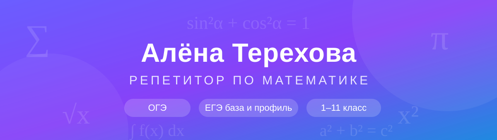

<picture>
  <source media="(max-width: 600px)" srcset="assets/banner-mobile.svg">
  
</picture>

  

*Математика становится понятной, когда её объясняют на понятном именно вам языке.*

---

## Обо мне

Меня зовут **Алёна Терехова**, и я помогаю школьникам подружиться с математикой — от первых действий с дробями до профильного ЕГЭ.

Я не заставляю зубрить формулы. Мы разбираемся, **почему** правило работает, учимся видеть логику в каждой задаче и доводим решение до автоматизма. Такой подход даёт не временный результат на экзамене, а уверенность, которая остаётся с учеником.

- Работаю с учениками **1–11 классов**
- Готовлю к **ОГЭ** и **ЕГЭ** (базовый и профильный уровни)
- Помогаю закрыть пробелы в школьной программе и повысить текущие оценки
- Объясняю спокойно, без давления и «страшных» слов

---

## Чем я могу помочь

| Направление | Кому подходит | Что входит |
| :--- | :--- | :--- |
| **Подготовка к ОГЭ** | 8–9 классы | Разбор всех типов заданий, отработка на реальных вариантах, стратегия экзамена и работа со стрессом |
| **Подготовка к ЕГЭ (база)** | 10–11 классы | Систематизация школьного курса, тренировка вычислительных навыков, уверенные баллы без лишней теории |
| **Подготовка к ЕГЭ (профиль)** | 10–11 классы | Задания первой и второй части, параметры, экономические и геометрические задачи, развёрнутые решения |
| **Школьная программа 1–11 класс** | Любой класс | Восполнение пробелов, разбор домашних заданий, подготовка к контрольным и ВПР |
| **Математика «с нуля»** | 5–9 классы | Возвращаемся к базе и шаг за шагом выстраиваем фундамент для дальнейшего обучения |

---

## Как проходят занятия

1. **Знакомство и диагностика** — определяем текущий уровень, цели и сроки.
2. **Индивидуальный план** — составляю программу под ученика, а не «по учебнику».
3. **Понятная теория** — каждое правило разбираем на жизненных примерах.
4. **Практика на реальных заданиях** — закрепляем материал на формате ОГЭ и ЕГЭ.
5. **Домашняя работа с проверкой** — объём посильный, разбор ошибок обязателен.
6. **Обратная связь** — ученик и родители видят прогресс и понимают, над чем работаем дальше.

---

## Форматы занятий

| Формат | Длительность | Особенности |
| :--- | :---: | :--- |
| **Индивидуально онлайн** | 60 минут | Максимальное внимание к ученику, гибкий темп и программа |
| **Мини-группа** | 60 минут | 2–4 человека, живое обсуждение и здоровая мотивация |
| **Интенсив перед экзаменом** | 60–90 минут | Повторение ключевых тем и тренировка на вариантах |

Занятия проходят онлайн — нужен только компьютер или планшет, стабильный интернет и желание разобраться. Все материалы, конспекты и домашние задания остаются у ученика.

---

## Результаты учеников

- Перестают бояться математики и выходят к доске без паники
- Повышают текущие оценки и уверенно пишут контрольные
- Сдают ОГЭ и ЕГЭ на баллы, достаточные для поступления в выбранный вуз
- Учатся самостоятельно проверять решения и находить свои ошибки
- Родители получают понятную картину успеваемости без «сюрпризов» в конце четверти

> Хороший результат — это не везение на экзамене, а система, которая работает весь учебный год.

---

## Почему со мной удобно

- **Понятная подача** — сложные темы объясняю простым языком и на примерах
- **Честная обратная связь** — говорю о реальном уровне и сроках, а не обещаю невозможного
- **Гибкий график** — подбираем время под школу и секции
- **Спокойная атмосфера** — можно ошибаться и задавать «глупые» вопросы
- **Работа на результат** — не просто «прошли тему», а довели до самостоятельного решения

---

## Частые вопросы

<b>С какого класса можно начинать подготовку к ОГЭ и ЕГЭ?</b>

 
Оптимально — за 1,5–2 года до экзамена, но всё индивидуально. Если база слабая, начинаем раньше; если ученик уверен в себе, хватит и нескольких месяцев интенсивной работы. На диагностике честно скажу, какой срок нужен в вашем случае.

<b>Сколько занятий в неделю нужно?</b>

 
Обычно достаточно 1–2 занятий в неделю плюс домашняя работа. Перед экзаменом нагрузку можно увеличить. Главное — регулярность, а не количество часов.

<b>Как проходят занятия онлайн?</b>

 
В видеозвонке с интерактивной доской: пишем, чертим графики, разбираем задачи в реальном времени. Ученик всегда может пересмотреть запись или конспект.

<b>Что делать, если нужно отменить занятие?</b>

 
Предупредите заранее — и мы перенесём занятие на удобное время без потери оплаты.

<b>Работаете ли вы с родителями?</b>

 
Да. По запросу рассказываю о прогрессе, даю рекомендации и объясняю, как помочь ребёнку дома.

---

## Контакты

### Запишитесь на первое занятие

Познакомимся, определим уровень и составим план подготовки.

| Связь | Контакт |
| :---: | :--- |
| **Telegram** | [@alena_teacher](https://t.me/alena_teacher) |
| **WhatsApp** | [+7 999 000-00-00](https://wa.me/79990000000) |
| **E-mail** | [alena.teacher@example.com](mailto:alena.teacher@example.com) |

*Стоимость и свободное время для занятий — в личных сообщениях.*

---

**Математика — это навык, а не талант. Давайте его разовьём.**

